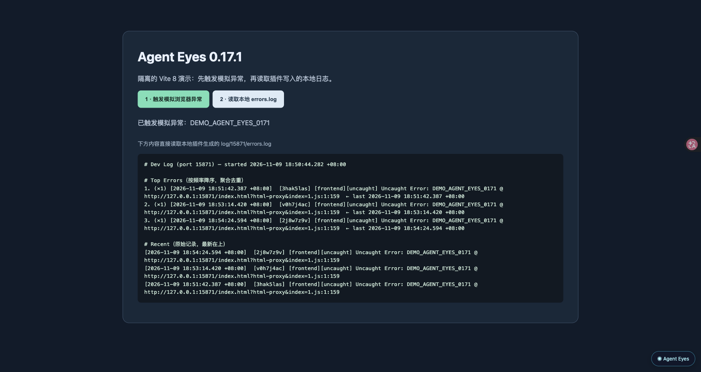

<div align="center">

<picture><source media="(prefers-color-scheme: dark)" srcset="https://cdn.jsdelivr.net/gh/webkubor/free-imgbed@main/vite-plugin-agent-eyes/mark-v3-dark.svg"></picture>

# 👀 vite-plugin-agent-eyes

**Give your AI agent eyes on the running website.** Errors, requests, routes, and screenshots become readable evidence. Humans get a visual panel right on the page.

<a href="https://www.npmjs.com/package/vite-plugin-agent-eyes"></a>
<a href="https://www.npmjs.com/package/vite-plugin-agent-eyes"></a>
<a href="https://github.com/webkubor/vite-plugin-agent-eyes/releases"></a>

[中文](./README.md) · [Documentation](https://webkubor.github.io/vite-plugin-agent-eyes/) · [Changelog](./CHANGELOG.md)

</div>

## See it in 30 seconds

<p align="center">
  
</p>

> The npm release 0.17.1 running in an isolated Vite 8 example: after a simulated browser error, the page reads the plugin's actual local `errors.log`. [Watch the demo](./assets/demo/agent-eyes-v0.17.1-demo.mp4) · [Capture details](./assets/demo/README.md).

| Before | With Agent Eyes |
|---|---|
| Send an agent a screenshot and explain which page it came from | Match the project and route, then label the screenshot with project, route, and time |
| Guess the environment and API target from config files | Read the startup banner: mode, proxies, aliases, and stack |
| Check robots, sitemap, and llms.txt by hand | Inspect them from the page; source files alone do not prove search indexing |
| Reproduce a bug and sift through scattered console and network output | Let the agent read structured errors, API calls, interactions, and proxy logs |
| Discover an env-flagged feature only after it ships | Commit guard blocks env-file drift: non-addressing vars must match across environments |

<div align="center">

**One setup, on by default.** Chrome screenshots need a CDP-enabled browser; other capabilities work out of the box. Turn off individual features if you don't need them.

</div>

## Start in a minute

```bash
pnpm add -D vite-plugin-agent-eyes
```

```ts
// vite.config.ts
import { defineConfig } from 'vite'
import { agentEyes } from 'vite-plugin-agent-eyes'

export default defineConfig({
  plugins: [...agentEyes()],
})
```

Run `vite dev`. A project summary appears in your terminal; the **Agent Eyes** entry appears at the bottom-right of the page. Already have a Vite proxy and need cookie or proxy diagnostics? Wrap its target with [`agentProxy()`](https://webkubor.github.io/vite-plugin-agent-eyes/api/agent-proxy). A proxy is optional for the basic setup.

Works with React, Vue, Svelte, Solid, and plain JS. CI verifies Vite 4–8; the peer range is `vite >=4 <10` (Vite 9 has not entered the matrix).

## A real 401, without guesswork

A login request succeeds, then the next call returns 401. Browser `fetch` cannot show the complete proxy `Set-Cookie` / `Cookie` exchange. `agentProxy()` records the actual request and response cookie attributes and repairs common Domain / Secure / SameSite problems in local HTTP development. [See the case study](https://webkubor.github.io/vite-plugin-agent-eyes/guide/case-401).

## Explore further

[Visual panel and screenshots](https://webkubor.github.io/vite-plugin-agent-eyes/guide/visual) · [Reading the logs](https://webkubor.github.io/vite-plugin-agent-eyes/guide/logs) · [Environment and engineering checks](https://webkubor.github.io/vite-plugin-agent-eyes/api/agent-project-guide) · [Pre-commit guard](https://webkubor.github.io/vite-plugin-agent-eyes/guide/guard) · [Full API](https://webkubor.github.io/vite-plugin-agent-eyes/api/agent-eyes)

Screenshots require one uniquely matching CDP page for the current project and route. Finding robots or a sitemap locally does not prove they are publicly reachable or indexed. Logs, panel, and screenshots are dev-only; the version stamp also applies to builds. [Installation notes and switches](https://webkubor.github.io/vite-plugin-agent-eyes/guide/install).

Leave the detailed debugging to [AGENT_GUIDE.md](./AGENT_GUIDE.md) and the generated `log/README.md`. To teach an agent to discover the tool on its own, use [AGENT_BOOTSTRAP.md](./AGENT_BOOTSTRAP.md).

## Star History

<a href="https://www.star-history.com/#webkubor/vite-plugin-agent-eyes&Date">
  <picture>
    <source media="(prefers-color-scheme: dark)" srcset="https://api.star-history.com/svg?repos=webkubor/vite-plugin-agent-eyes&amp;type=Date&amp;theme=dark" />
    <source media="(prefers-color-scheme: light)" srcset="https://api.star-history.com/svg?repos=webkubor/vite-plugin-agent-eyes&amp;type=Date" />
    
  </picture>
</a>

MIT · [Issues](https://github.com/webkubor/vite-plugin-agent-eyes/issues)
