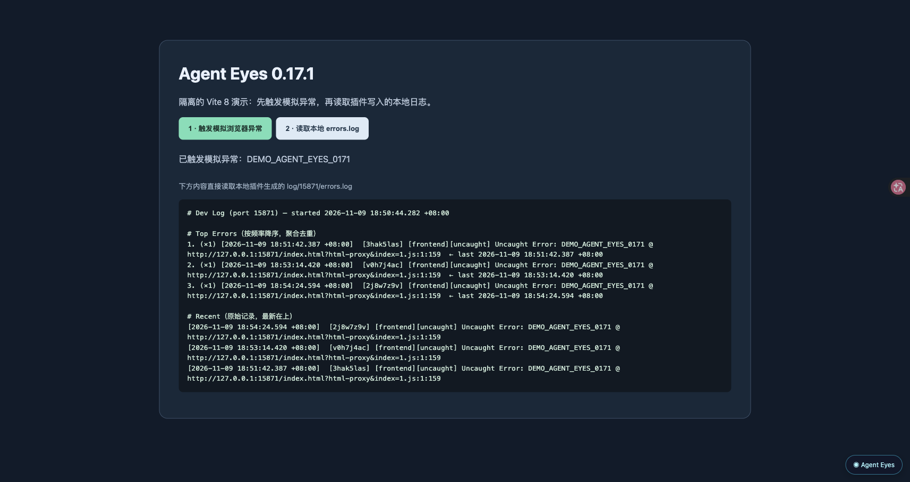

<div align="center">

<picture><source media="(prefers-color-scheme: dark)" srcset="https://cdn.jsdelivr.net/gh/webkubor/free-imgbed@main/vite-plugin-agent-eyes/mark-v3-dark.svg"></picture>

<h1 align="center">👀 vite-plugin-agent-eyes</h1>

**让 AI agent 看见正在运行的网站。** 运行时错误、接口、路由和页面截图落成可读线索；人打开网页就能看见可视化面板。

<a href="https://www.npmjs.com/package/vite-plugin-agent-eyes"></a>
<a href="https://www.npmjs.com/package/vite-plugin-agent-eyes"></a>
<a href="https://github.com/webkubor/vite-plugin-agent-eyes/releases"></a>

[English](./README.en.md) · [在线文档](https://webkubor.github.io/vite-plugin-agent-eyes/) · [更新日志](./CHANGELOG.md)

</div>

## 30 秒看懂它

<p align="center">
  
</p>

> 这是 npm 版 0.17.1 在隔离 Vite 8 示例中的真实画面：触发模拟异常后，页面读取插件写出的本地 `errors.log`。[素材与采样说明](./assets/demo/README.md)。

https://github.com/user-attachments/assets/e039b812-c366-421f-9f08-afdee5ea428a

| 以前排查要做的事 | 现在打开网页就能看到 |
|---|---|
| 截图发给 agent，再解释“我在哪个页面” | 按项目和路由匹配标签页，截图带项目、路由与时间标记 |
| 翻配置猜当前连了哪个 API、用哪个环境 | 启动横幅直接列环境、代理目标、别名和技术栈 |
| 手工确认 robots、sitemap、llms.txt | 网页面板显示文件状态与风险；源码存在不等于线上已收录 |
| 复现错误后翻散落的 console 和网络请求 | 结构化错误、API、交互与代理层日志留给 agent 自己读 |
| 上线才发现某个 env 开关只在测试环境有 | 提交时硬拦环境文件分叉：非寻址类变量两环境必须一致 |

<div align="center">

**一次接入，默认开启。** 除了 Chrome 截图需要浏览器开放 CDP，其余能力开箱即用；不需要的能力可单独关闭。

</div>

## 一分钟接入

```bash
pnpm add -D vite-plugin-agent-eyes
```

```ts
// vite.config.ts
import { defineConfig } from 'vite'
import { agentEyes } from 'vite-plugin-agent-eyes'

export default defineConfig({
  plugins: [...agentEyes()],
})
```

启动 `vite dev`，终端会显示项目概况，网页右下角会出现 **Agent Eyes**。已有 Vite 代理想查 cookie 和代理请求时，可以把 target 包成 [`agentProxy()`](https://webkubor.github.io/vite-plugin-agent-eyes/api/agent-proxy)；基础接入不需要代理配置。

React、Vue、Svelte、Solid 与原生 JS 均可用。CI 验证 Vite 4–8；安装声明为 `vite >=4 <10`（Vite 9 尚未进矩阵）。

## 真实的 401，别让 agent 盲猜

登录请求成功，下一个接口却返回 401。浏览器 `fetch` 看不到完整的 `Set-Cookie` / `Cookie` 代理链路；`agentProxy()` 会记录实际请求与响应的 cookie 属性，并在本地 HTTP 开发环境修正常见的 Domain / Secure / SameSite 问题。[看这个案例](https://webkubor.github.io/vite-plugin-agent-eyes/guide/case-401)。

## 更多能力与边界

[可视化面板与截图](https://webkubor.github.io/vite-plugin-agent-eyes/guide/visual) · [日志怎么看](https://webkubor.github.io/vite-plugin-agent-eyes/guide/logs) · [环境与工程体检](https://webkubor.github.io/vite-plugin-agent-eyes/api/agent-project-guide) · [提交前 Guard](https://webkubor.github.io/vite-plugin-agent-eyes/guide/guard) · [完整 API](https://webkubor.github.io/vite-plugin-agent-eyes/api/agent-eyes)

截图仅在找到**唯一匹配当前项目与路由**的 CDP 页面时生成；检测到 robots / sitemap 也不代表线上可访问或已收录。运行时日志、面板和截图只在 dev 生效；版本戳记也参与构建。详细条件与关闭选项见[文档](https://webkubor.github.io/vite-plugin-agent-eyes/guide/install)。

复杂排障留给 [AGENT_GUIDE.md](./AGENT_GUIDE.md) 和自动生成的 `log/README.md`；如果需要让 agent 主动发现插件，读 [AGENT_BOOTSTRAP.md](./AGENT_BOOTSTRAP.md)。

## Star History

<a href="https://www.star-history.com/#webkubor/vite-plugin-agent-eyes&Date">
  <picture>
    <source media="(prefers-color-scheme: dark)" srcset="https://api.star-history.com/svg?repos=webkubor/vite-plugin-agent-eyes&amp;type=Date&amp;theme=dark" />
    <source media="(prefers-color-scheme: light)" srcset="https://api.star-history.com/svg?repos=webkubor/vite-plugin-agent-eyes&amp;type=Date" />
    
  </picture>
</a>

MIT · [Issues](https://github.com/webkubor/vite-plugin-agent-eyes/issues)
