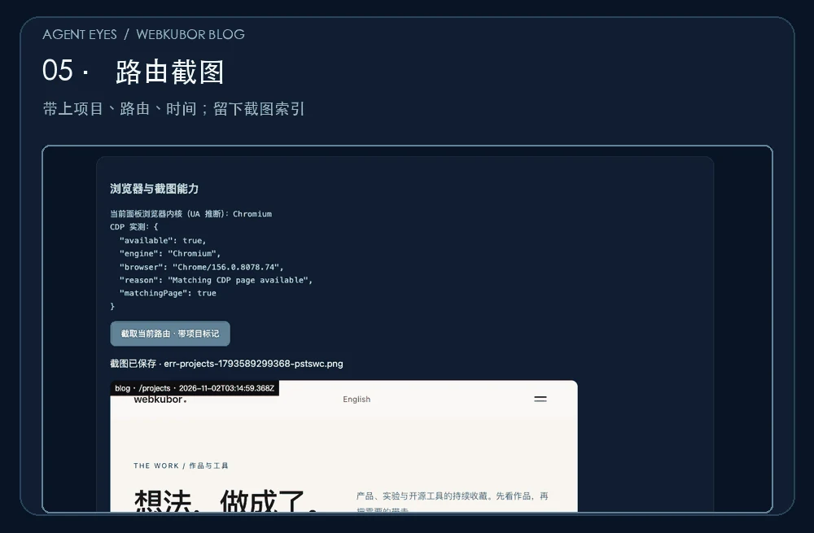

# README 演示素材

`agent-eyes-blog-walkthrough.gif` 使用 [webkubor 博客](https://webkubor.online/) 的本地 Vite dev 实录制作。画面依次为 `/projects` 作品路由、页面右下角 Agent Eyes 入口、博客实际的 robots/sitemap/llms.txt 检查结果、Chrome 156 CDP 页面匹配状态，以及按路由完成截图后的面板。博客当前 sitemap 有 54 个 `<loc>`；画面里的这些数字来自录制当时的本地项目，不是恒定的产品指标。

截图由 ego-browser 在本地浏览器会话中取得。演示使用单独启动的 Vite dev 进程加载本仓插件，博客仓库的 `vite.config.ts` 和已有 WIP 未改动。CDP 截图测试使用单独 Chrome 调试进程匹配同一博客路由。GIF 没有改写截图内容，只有裁剪、缩放和标题/副标题。

静态预览：



重新制作：先以同名文件准备 4 张真实浏览器截图（`/tmp/agent-eyes-demo-projects-stable.png`、`/tmp/agent-eyes-demo-crawler-centered.png`、`/tmp/agent-eyes-demo-04.png`、`/tmp/agent-eyes-demo-05.png`），再运行：

```bash
python3 scripts/build-readme-demo.py --source /tmp --output assets/demo/agent-eyes-blog-walkthrough.gif
```

脚本需要 Pillow 与中文字体。自动寻找 macOS / Linux / Windows 常见中文字体；也可传 `--font /path/to/NotoSansCJK-Regular.ttc` 指定字体。输出为 5 帧循环 GIF；首屏加载约 0.14 MiB。更换网站演示时请替换真实源图和标题，避免图文不符。
